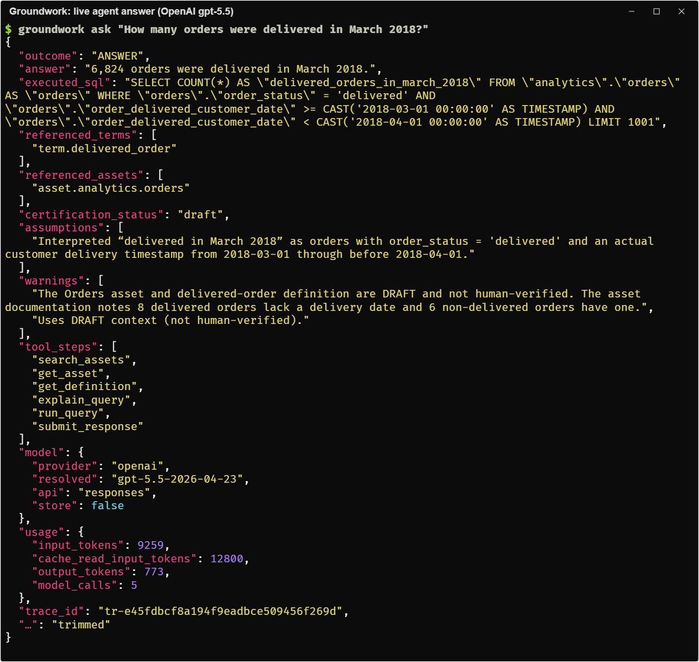
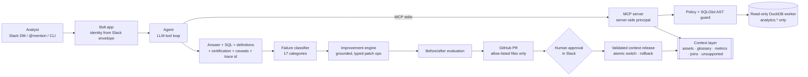
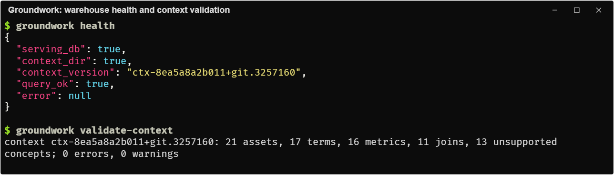
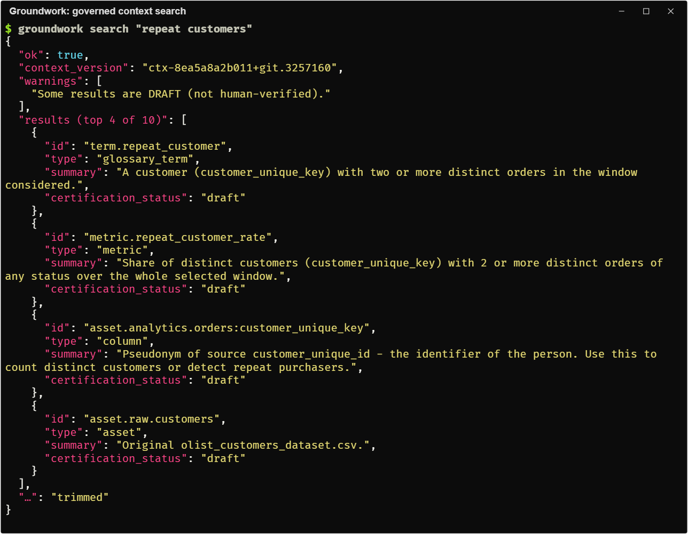
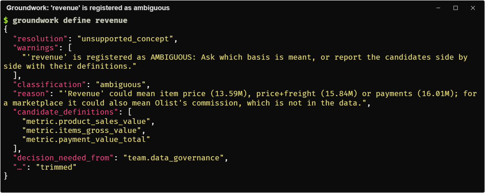
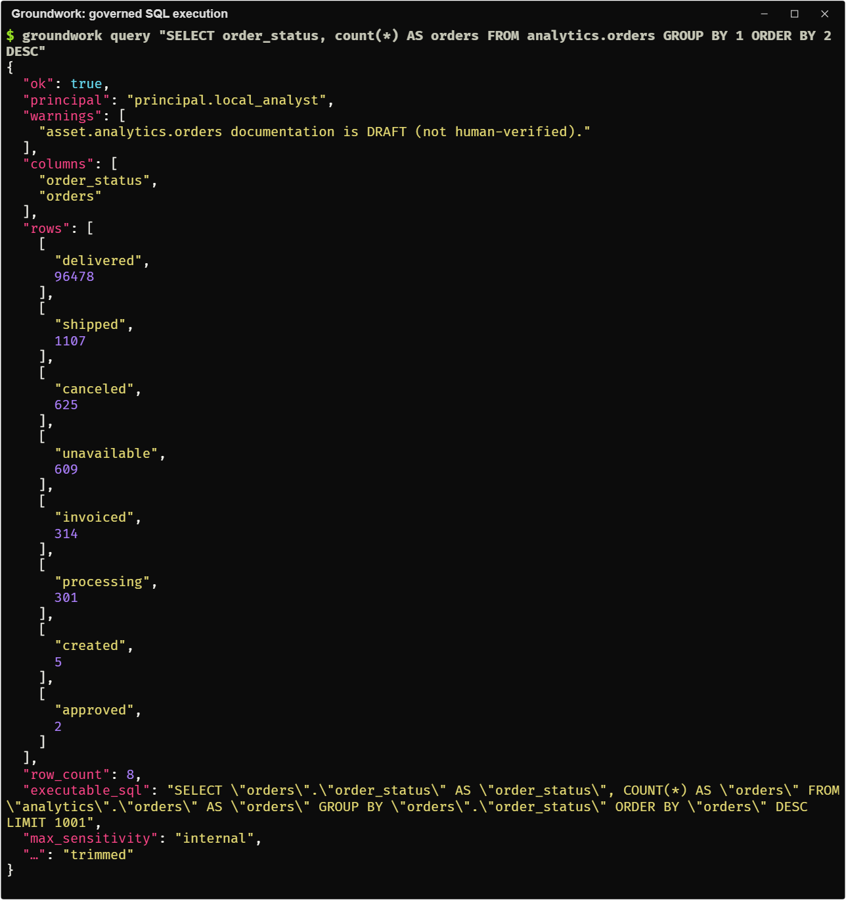
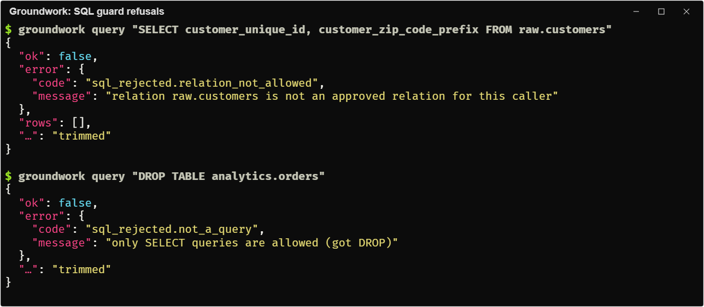
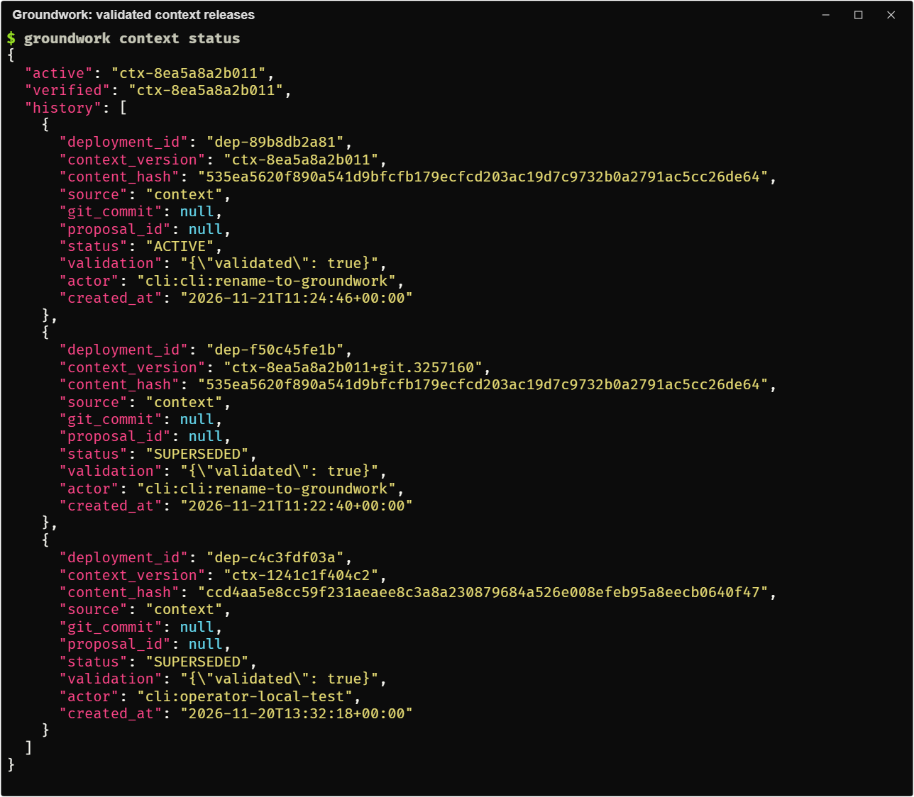
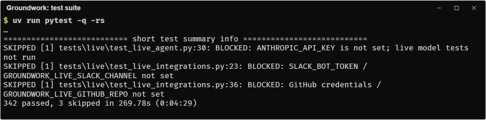

# Groundwork

**Governed business context for AI data agents, with a human-approved feedback loop.**

Groundwork puts a version-controlled **context layer** and a secure **MCP server** in front of a
real DuckDB warehouse (the public Olist e-commerce dataset). An LLM agent answers analytics
questions through that layer and shows the SQL and definitions it used. It refuses, or asks a
clarifying question, when the business meaning is ambiguous. Failures turn into evidence-backed
fix proposals, which reach production only through human approval, GitHub review and evaluation.



<sub>A real answer from OpenAI `gpt-5.5` via `groundwork ask`. 6,824 matches the gold answer for
eval case `cf-017`. The image is rendered from the stored trace and trimmed to the relevant fields. The call was made before the project was renamed from ContextForge, when the command was `contextforge ask`.</sub>

## Project status

| Area | State |
|---|---|
| Warehouse, context layer, MCP server, SQL guard | ✅ Built and tested against the real data |
| Agent (OpenAI / Anthropic), 3 context modes | ✅ Built. OpenAI is **live-verified** with a smoke test and one real answer. |
| Evaluation platform (90 cases, held-out lock, statistics, gate) | ✅ Built. The full experiment is **not done**: it stopped at 24 of 630 attempts because of the API budget, and those attempts are not a result. |
| Slack app, proposals, approvals, GitHub PRs, audit, releases | ✅ Built and tested with contract tests and local fakes. ❌ Not connected to a real Slack or GitHub yet. |
| Deployment and pilot | ❌ Not deployed. 0 real users, 0 approvals, 0 PRs. |
| Context certification | ⚠️ All definitions are AI-drafted `draft`. Gold labels are not human-reviewed. |

The detailed state, including where the end-to-end chain stops, is in
[`docs/PHASE_3_HANDOFF.md`](docs/PHASE_3_HANDOFF.md) and [`docs/IMPLEMENTATION_STATUS.md`](docs/IMPLEMENTATION_STATUS.md).

## The problem

Given only a raw schema, an LLM writes plausible SQL that is often wrong in business terms:

- **Wrong count:** it counts `customer_id` (issued per order) as people.
- **Fanout:** it sums payments after joining order items, multiplying them.
- **Wrong definition:** it calls item price "revenue" when three valid bases exist.
- **Invented answers:** it answers "net revenue" even though refunds are not recorded.

Groundwork fixes this with governed context:
- definitions with an explicit grain;
- join and fanout rules;
- an unsupported/ambiguous register;
- certification states;
- data-quality caveats.

The hard part is keeping that context correct and current. That is what the feedback loop is for.

## Architecture



**Why MCP:** there is one governed tool surface (search, definitions, joins, policy, explain, run)
that any agent can use. Identity and permissions are fixed in the server process, so a prompt
cannot widen access. More detail: [`docs/ARCHITECTURE.md`](docs/ARCHITECTURE.md) and
[`docs/AGENT_ARCHITECTURE.md`](docs/AGENT_ARCHITECTURE.md).

## Screenshots

Every image below is rendered from the real output of the command shown, run in this repository.
Long JSON is trimmed to the relevant fields, and each trim is marked `…`.

### 1. Warehouse health and context validation
The serving warehouse is reachable, and the context repository cross-validates against the real
schema: 21 assets, 17 terms, 16 metrics, 11 joins, 13 unsupported concepts, with 0 errors.



### 2. Governed context search
Search returns typed context objects. Each one carries its certification status, and a
DRAFT warning is always shown.



### 3. Ambiguity is a first-class answer
"Revenue" has three defensible bases in this data. Instead of a guess, the context layer
returns the candidates and names who has to decide.



### 4. Governed SQL execution
The caller's SQL is parsed and checked against an allow-list. It is then regenerated with a row
cap and run in a killable, read-only worker. Only the regenerated SQL is executed.



### 5. The guard refuses what policy forbids
Raw tables, which contain PII, are not approved relations, and anything other than `SELECT` is
rejected before it reaches the database.



### 6. Live agent answer
This is the image at the top of the page. The agent searched the context, read the asset and the
`delivered_order` definition, explained and then ran the query, and submitted a structured answer.
That answer includes its assumptions, the DRAFT warning and a data-quality caveat.

### 7. Validated context releases
Context is deployed as immutable, hash-verified releases with history and rollback.



### 8. Test suite
This run had no model key set, so the live tests skip and are reported as **BLOCKED**. A skip is
never counted as a pass.



## Quick start (local)

**Prerequisites:**
- [uv](https://docs.astral.sh/uv/) 0.13+ and Python 3.12;
- network access to kaggle.com (the dataset is downloaded anonymously).

```bash
uv sync --frozen
uv run groundwork acquire && uv run groundwork build && uv run groundwork quality
uv run groundwork validate-context
uv run groundwork context deploy --path context --actor "$USER"   # first validated release

# No model key needed for these:
uv run groundwork search "repeat customers"
uv run groundwork define revenue
uv run groundwork query "SELECT order_status, count(*) FROM analytics.orders GROUP BY 1"

# Live agent (otherwise BLOCKED, exit 3; it never falls back silently):
export GROUNDWORK_PROVIDER=openai OPENAI_API_KEY=...
uv run groundwork ask "How many orders were delivered in March 2018?"
```

On Windows PowerShell, set the key with `$env:OPENAI_API_KEY = "sk-..."` (current terminal) or
`[Environment]::SetEnvironmentVariable("OPENAI_API_KEY", "sk-...", "User")` (permanent). Never
commit it. If Kaggle requires authentication, set `KAGGLE_USERNAME`/`KAGGLE_KEY`, or use
`acquire --zip archive.zip`.

## How it works

### Warehouse
- **Raw tables:** loaded from the original CSVs, which are checksum-verified.
- **Serving schema (`analytics.*`):** pseudonymised, with HMAC keys, no ZIP codes, and review text reduced to flags.
- **Agent access:** the agent can query only the serving schema.

### Context layer
`context/` holds YAML for:
- assets;
- the glossary;
- metrics, each with SQL and a double-counting check;
- joins;
- the unsupported/ambiguous register;
- ownership;
- policy.

It is typed, cross-validated against the real schema, and versioned. Only humans can certify.
See [`docs/CONTEXT_GOVERNANCE.md`](docs/CONTEXT_GOVERNANCE.md).

### Agent outcomes
Every answer has one of six outcomes:
- `ANSWER`, which must reference a query that actually succeeded;
- `CLARIFICATION_REQUIRED`;
- `INSUFFICIENT_CONTEXT`;
- `UNSUPPORTED_QUESTION`;
- `POLICY_DENIED`;
- `EXECUTION_ERROR`.

The provider (OpenAI Responses API or Anthropic) is always explicit, with no fallback.

### Security
**Enforced in code, independent of model behaviour:**
- a server-side principal;
- an AST SQL allow-list;
- a locked, killable read-only worker;
- an allow-listed MCP environment;
- outbound secret scrubbing.

**Approvals:**
- reviewers are authorized on the backend;
- stale, replayed and self-approvals are refused;
- proposals may touch only allow-listed files;
- every decision lands in a hash-chained, append-only audit log.

See [`docs/SECURITY.md`](docs/SECURITY.md) and [`docs/THREAT_MODEL.md`](docs/THREAT_MODEL.md).

### Evaluation
- **Cases:** 90, with gold SQL executed on a frozen snapshot and a locked held-out split.
- **Modes:** three context modes (`raw_schema`, `descriptions`, `full_context`), enforced server-side.
- **Statistics:** paired, question-level bootstrap and McNemar/Holm.
- **Gate:** a regression gate where BLOCKED never counts as PASS.

See [`docs/EVALUATION_METHODOLOGY.md`](docs/EVALUATION_METHODOLOGY.md). Results:
[`docs/EXPERIMENT_RESULTS.md`](docs/EXPERIMENT_RESULTS.md). No numbers are invented.

### Context-fix loop
1. **Diagnose:** a classified failure.
2. **Route:** the owner gets a business-decision request, or a grounded draft is created. Drafts are typed operations that cite real columns, executed query ids and traces.
3. **Validate:** the agent is re-run on the current and the proposed context, plus regression cases.
4. **Open a PR:** only allow-listed files can change.
5. **Approve:** an authorized reviewer approves the exact revision in Slack.
6. **Merge:** on GitHub, under branch protection.
7. **Deploy:** a validated release is built from the merge commit.

Approving answers in shadow mode is a separate workflow. See
[`docs/HUMAN_APPROVALS.md`](docs/HUMAN_APPROVALS.md).

## Commands

| Task | Command |
|---|---|
| Data | `groundwork acquire` · `build` · `quality` · `validate-context` · `health` |
| MCP server (stdio) | `groundwork serve` |
| Governed access | `groundwork search "…"` · `define <term>` · `query "SELECT …"` |
| Agent | `groundwork ask "<question>" [--provider openai] [--model gpt-5.5] [--mode full_context]` |
| Evaluation | `groundwork eval run\|report\|compare\|replay\|list\|gate` · `eval gold freeze\|check\|status\|lock\|verify\|review` |
| Slack product | `groundwork product check` · `product run [--http PORT]` · `product ops` |
| Context releases | `groundwork context deploy --path DIR\|--git-commit SHA --actor NAME` · `context rollback` · `context status` |
| Proposals | `groundwork proposals list\|show\|draft\|validate\|open-pr\|sync\|eligible\|deploy` · `failures` |
| Audit / pilot / ops DB | `groundwork audit verify\|export` · `pilot report\|export\|purge` · `opsdb migrate\|backup` |

## Running the full experiment

This needs a model key and a real budget: about $0.07 per attempt on `gpt-5.5`, so about $40–50
for the full 630-attempt run.

```bash
uv run groundwork eval gold verify
uv run groundwork eval run --all --split heldout --repetitions 3 --concurrency 3 --kind experiment --label phase2-full
uv run groundwork eval report --run-id <id> && uv run groundwork eval gate --run-id <id>
```

To make a budget enforceable, set `GROUNDWORK_PRICES_FILE`. No OpenAI prices are built in.

## Slack deployment (pilot)

1. Create the app from `deploy/slack/manifest.yaml` (3 bot scopes, Socket Mode).
2. Fill in `deploy/.env` and `config/product.yaml`.
3. Run `docker compose --profile setup run --rm setup`.
4. Deploy a context release.
5. Run `docker compose up -d app`.

Full checklist: [`docs/DEPLOYMENT.md`](docs/DEPLOYMENT.md). Operations:
[`docs/RUNBOOK.md`](docs/RUNBOOK.md). Pilot plan: [`docs/PILOT_PROTOCOL.md`](docs/PILOT_PROTOCOL.md).

## Tests

| Suite | Runs against |
|---|---|
| `tests/unit` | Pure logic, plus contract tests: Slack Bolt (signed requests), GitHub (REST fake), OpenAI (HTTP mock) |
| `tests/integration`, `tests/security`, `tests/mcp` | The real warehouse and the real MCP server over stdio |
| `tests/agent` | The real runtime, MCP and DuckDB with a labelled **scripted model** test double |
| `tests/live` | The real model, Slack and GitHub. Each test skips as **BLOCKED** without credentials. |

## Using the MCP server directly

```json
{"mcpServers": {"groundwork": {"command": "uv", "args": ["--directory", "/path/to/groundwork", "run", "groundwork", "serve"],
  "env": {"GROUNDWORK_PRINCIPAL": "principal.local_analyst"}}}}
```

**Tools:**
- `search_assets`
- `get_asset`
- `get_definition`
- `get_join_path`
- `get_policy`
- `explain_query`
- `run_query`
- `validate_context` (admin only)

Remote (HTTP) MCP stays disabled until OAuth is implemented.

## Documentation map

| Doc | What it covers |
|---|---|
| [`PHASE_3_HANDOFF.md`](docs/PHASE_3_HANDOFF.md) | Completion levels per feature; where the E2E chain stops; human actions needed |
| [`IMPLEMENTATION_STATUS.md`](docs/IMPLEMENTATION_STATUS.md) | What is real, tested, live-verified or blocked |
| [`ARCHITECTURE.md`](docs/ARCHITECTURE.md) · [`AGENT_ARCHITECTURE.md`](docs/AGENT_ARCHITECTURE.md) | System and agent design |
| [`SECURITY.md`](docs/SECURITY.md) · [`THREAT_MODEL.md`](docs/THREAT_MODEL.md) | Controls and threats |
| [`EVALUATION_METHODOLOGY.md`](docs/EVALUATION_METHODOLOGY.md) · [`EXPERIMENT_RESULTS.md`](docs/EXPERIMENT_RESULTS.md) · [`FINAL_EVALUATION.md`](docs/FINAL_EVALUATION.md) | Pre-registered method and (honest) results |
| [`CONTEXT_GOVERNANCE.md`](docs/CONTEXT_GOVERNANCE.md) · [`HUMAN_APPROVALS.md`](docs/HUMAN_APPROVALS.md) | Certification and approval workflows |
| [`DEPLOYMENT.md`](docs/DEPLOYMENT.md) · [`RUNBOOK.md`](docs/RUNBOOK.md) | Running it |
| [`PILOT_PROTOCOL.md`](docs/PILOT_PROTOCOL.md) · [`PILOT_RESULTS.md`](docs/PILOT_RESULTS.md) · [`DEMO_SCRIPT.md`](docs/DEMO_SCRIPT.md) | Pilot and demo |

## Limitations

- **Not live-verified yet:** Slack and GitHub. Docker deployment is also unverified.
- **Model verification:** the live model is verified by a smoke test only. No complete evaluation exists.
- **Drafts only:** all context is draft, and gold labels are not human-reviewed.
- **Audit log:** tamper-evident, not tamper-proof.
- **Scale:** one SQLite operational DB on one VM, which suits a 5–10 user pilot.
- **Data:** a single domain and dataset.

## Contributing

- **Invariants:** read [`AGENTS.md`](AGENTS.md) first.
- **Before finishing a change:** run `uv run ruff check src tests && uv run mypy && uv run groundwork validate-context && uv run groundwork eval gold check && uv run pytest -q`.
- **Context changes:** go through PRs, and only humans certify.
- **Held-out cases:** never edit them.

## License and data

- **Code:** Apache-2.0.
- **Data:** Olist, **CC BY-NC-SA 4.0** (non-commercial, share-alike). It is downloaded at setup and not redistributed. `evals/expected/*.json` holds small aggregate results derived from it, under the same licence.
